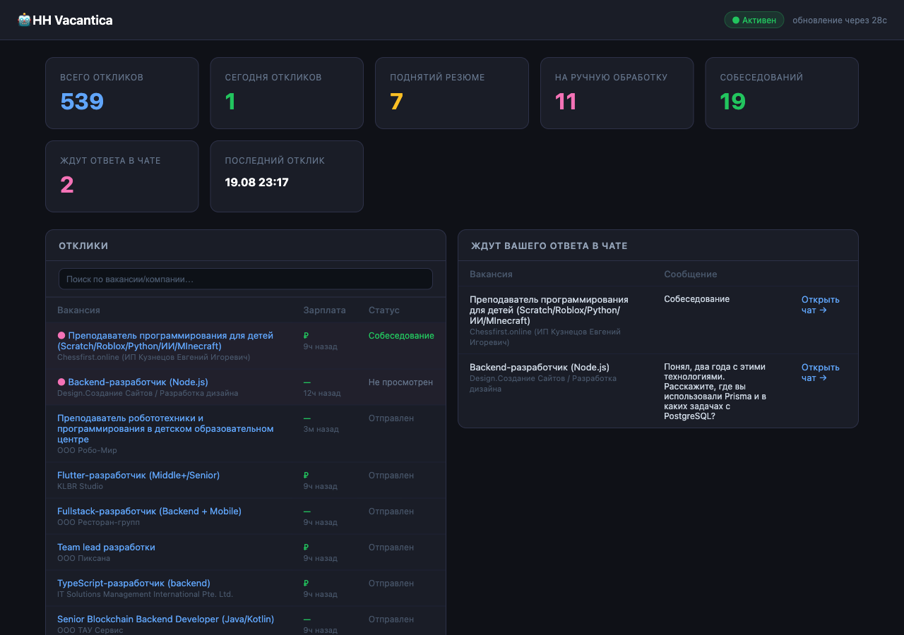
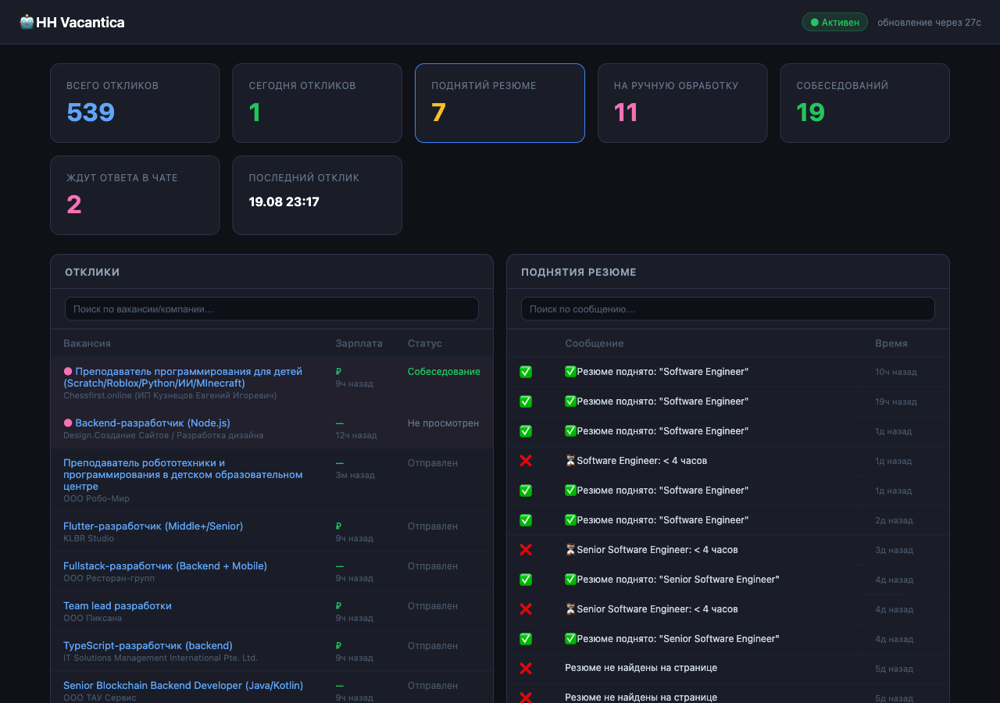
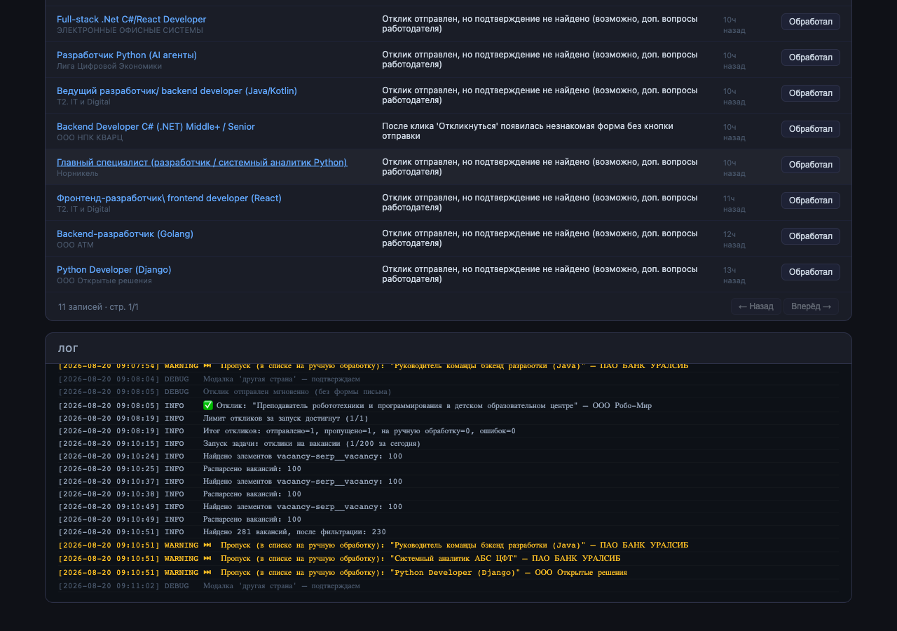

# 🤖 HH Vacantica

Бот-ассистент для поиска работы на [hh.ru](https://hh.ru): сам находит подходящие вакансии,
откликается на них, поднимает резюме в поиске, следит за статусами откликов и чатами —
и показывает всё это в живом веб-дашборде.

Работает 24/7 через Playwright (headless Chromium) + планировщик APScheduler, поверх
реальной авторизованной сессии hh.ru.

## Демо

### Главный экран
Отклики со статусами (Просмотрен / Собеседование / Отказ) + список чатов, где работодатель
уже ответил и ждёт вашего ответа — с прямой ссылкой на чат.



### Переключение панели одним кликом
Клик по карточке "Поднятий резюме" или "Ждут ответа в чате" переключает правую колонку
между этими двумя списками — они не занимают место одновременно.



### Ручная обработка и живой лог
Вакансии, которые бот не смог довести до конца сам (незнакомая форма, доп. вопросы
работодателя), падают в отдельный список — с причиной и кнопкой "Обработал", которая
прячет вакансию из списка, не давая боту случайно откликнуться туда повторно.



## Что умеет

- **Автоотклик на вакансии** — ищет по ключевым словам, фильтрует чёрные списки
  (компании/должности), откликается с сопроводительным письмом, уважает дневной лимит
  hh.ru (200 откликов/24ч) и сам делает паузу при капче DDoS-Guard.
- **Поднятие резюме** в поиске по расписанию.
- **Синхронизация статусов** — раз в 30 минут подтягивает из hh.ru реальный статус
  каждого отклика (Просмотрен / Собеседование / Отказ) и список чатов с непрочитанными
  сообщениями — без захода в каждый чат по отдельности.
- **Дашборд** (Flask, обновляется каждые 30 сек): счётчики, таблицы с поиском и
  пагинацией, прямые ссылки на чаты, скрываемый список "ручной обработки".
- **Устойчивость** — распознаёт разлогин, лимит откликов hh.ru и DDoS-Guard как разные
  ситуации и реагирует на каждую по-своему (бэкофф, повтор попытки, ручная обработка),
  вместо того чтобы тихо генерировать мусорные ошибки.

## Как это устроено

```
main.py           планировщик задач (APScheduler) + точка входа
browser.py        Playwright: сессия, авторизация, детекция DDoS-Guard
vacancies.py      поиск вакансий и отклик на них
resume.py         поднятие резюме в поиске
negotiations.py   синхронизация статусов откликов и непрочитанных чатов
database.py       SQLite: отклики, поднятия, ручная обработка, лимиты
dashboard.py      веб-дашборд (Flask) + webhook автодеплоя
config.py         вся настройка в одном месте
```

## Запуск

```bash
python -m venv .venv
source .venv/bin/activate
pip install -r requirements.txt
playwright install chromium
```

Первый раз — ручной вход в hh.ru (откроется окно браузера):

```bash
python main.py --login
```

Дальше — постоянная работа по расписанию + дашборд на `:8888`:

```bash
python main.py
```

Разовый тестовый прогон без ожидания расписания:

```bash
python main.py --now-respond   # отклики
python main.py --now-publish   # поднятие резюме
```

## Настройка

Всё — в [`config.py`](config.py): ключевые слова поиска, чёрные списки компаний/должностей,
лимит откликов за прогон, интервалы, шаблон сопроводительного письма. Логин/пароль и
секрет вебхука — через `.env` (см. `os.getenv(...)` в `config.py`).

## Профили поиска и второе резюме

В `config.SEARCH_PROFILES` два профиля, бот чередует их от прогона к прогону:

| Профиль | Что ищет | Резюме / письмо |
|---|---|---|
| `dev` | разработка (как раньше) | резюме подставляет hh.ru, исходное письмо |
| `remote_ai` | **только удалёнка**, свежие (3 дня) не-IT вакансии с упором на ИИ; в названии нет разработчика/тестировщика/инженера | второе резюме из [`resumes/resume_ai_remote.md`](resumes/resume_ai_remote.md), своё письмо |

Для `remote_ai` бот выбирает в окне отклика резюме с названием из `RESUME_TITLE_REMOTE`
(`.env`); если выбрать не удалось — вакансия уходит в «ручную обработку» со скриншотом,
отклик не отправляется. Разовый прогон одного профиля:

```bash
python main.py --now-respond --profile remote_ai
```

## ⚠️ Важно

- Это автоматизация действий на стороннем сайте — используйте на свой риск и в
  соответствии с пользовательским соглашением hh.ru.
- hh.ru жёстко ограничивает автоматических клиентов: лимит 200 откликов/сутки и
  DDoS-Guard при подозрительном паттерне трафика. Не гоняйте интервал отклика слишком
  агрессивно — можно поймать капчу или временную блокировку аккаунта.
- Бот не пытается обходить капчу — при её появлении просто откладывает попытки.
